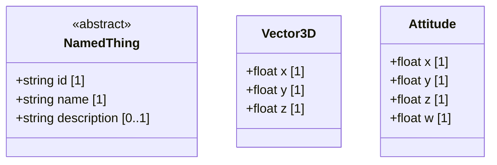
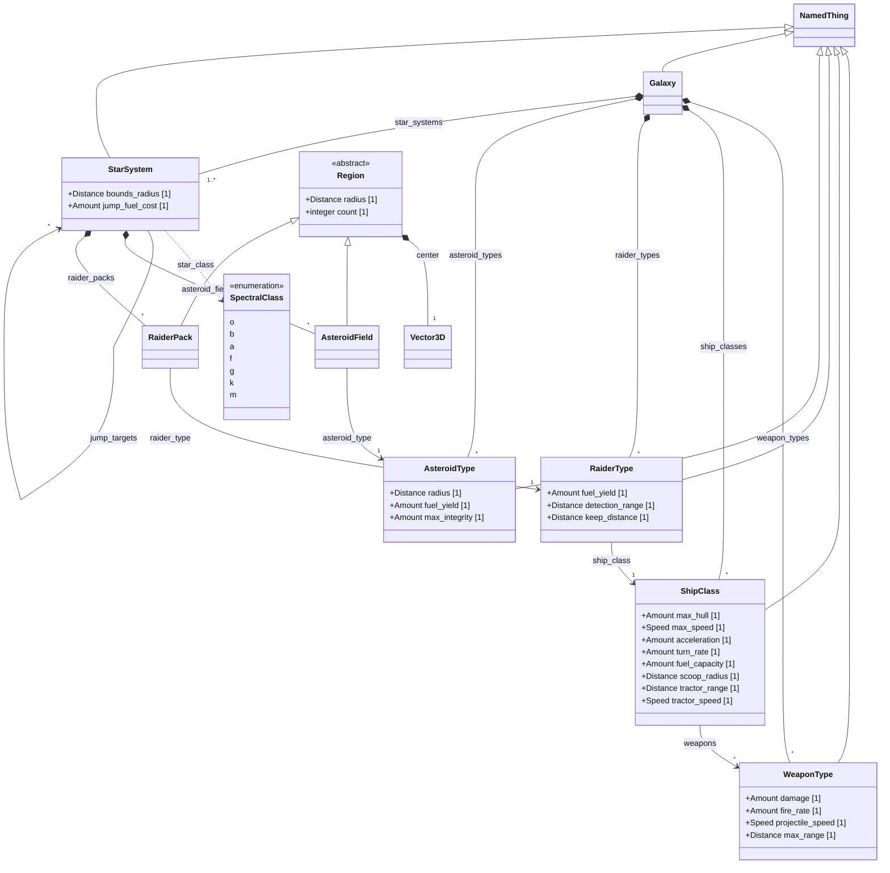
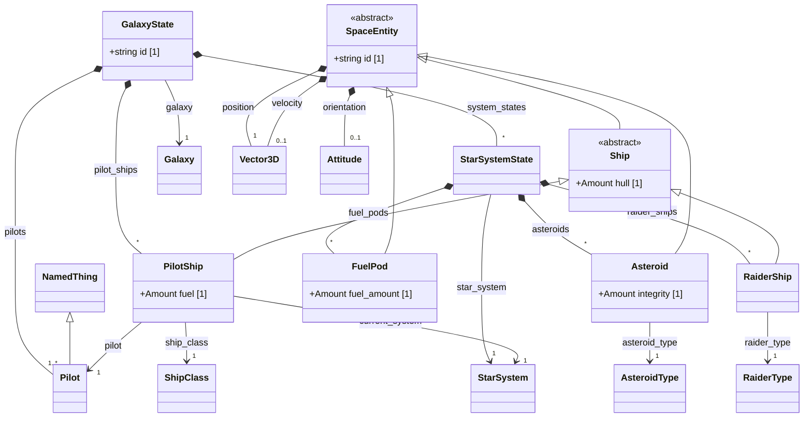

# Ontology graph

Generated by `just gen-graph` from the schema. Do not edit.

One diagram per subset. Empty boxes are classes from another subset.

`<|--` is_a · `*--` contains (inlined) · `-->` references by id · `..>` enum value

## Core

Building blocks shared by content and state.

## Content

What exists in a galaxy, rooted at Galaxy.

## State

What is where at one moment, rooted at GalaxyState.

