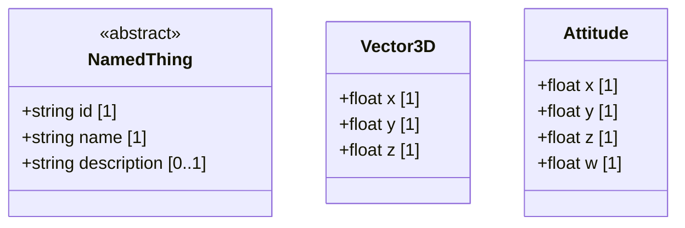
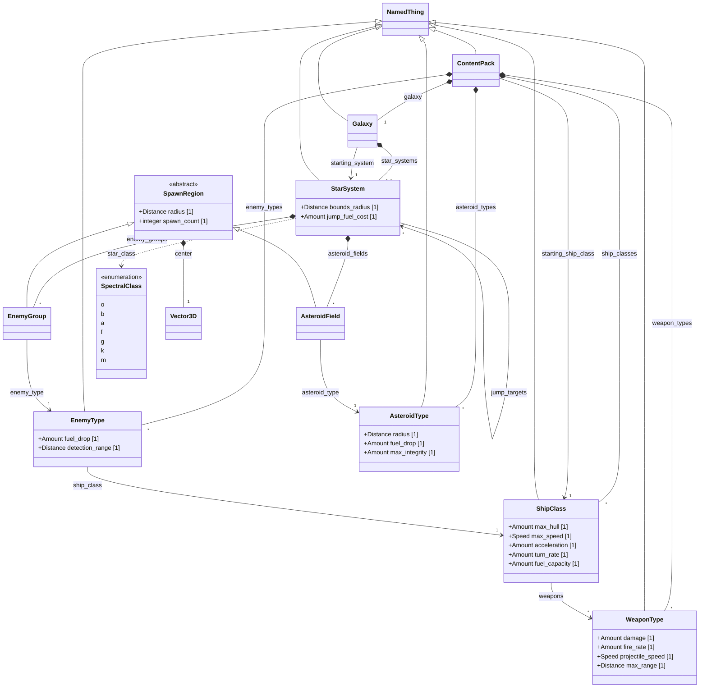
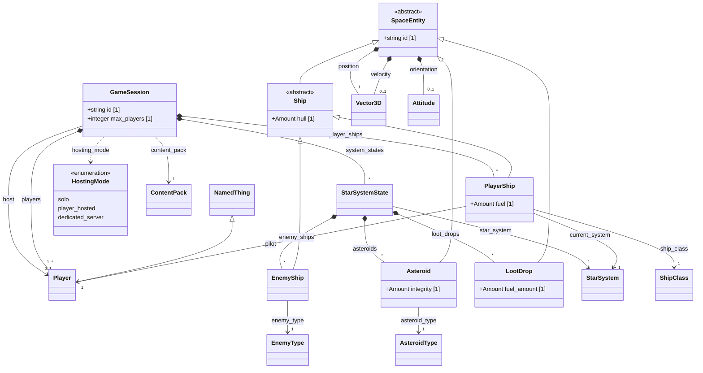

# Ontology graph

Generated by `just gen-graph` from the schema. Do not edit.

One diagram per subset. Empty boxes are classes from another subset.

`<|--` is_a · `*--` contains (inlined) · `-->` references by id · `..>` enum value

## Core

Building blocks shared by content and state.

## Content

Static, designer-authored definitions bundled in a ContentPack.

## State

Persisted and replicated session state, rooted at GameSession.

